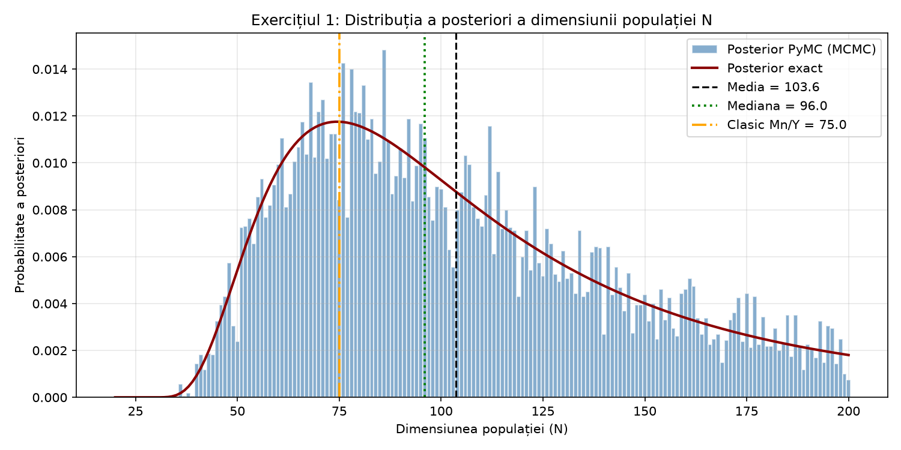
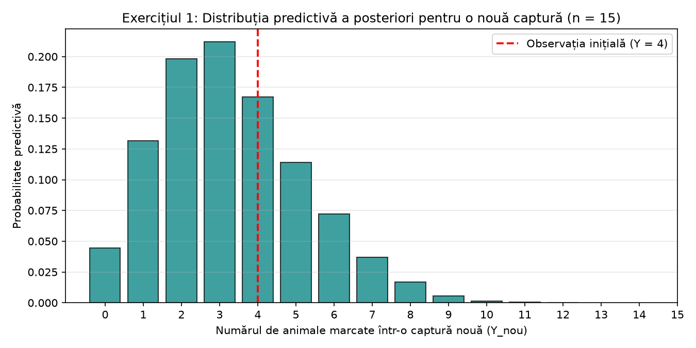
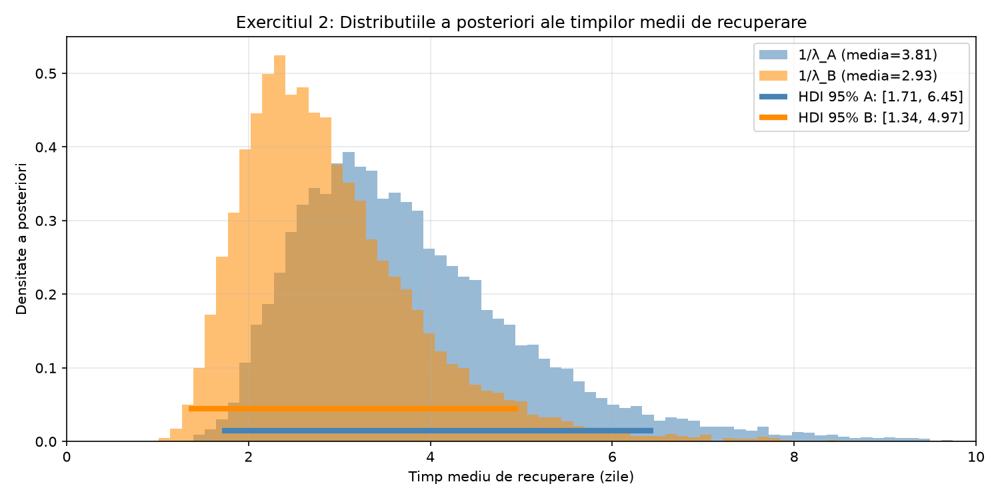
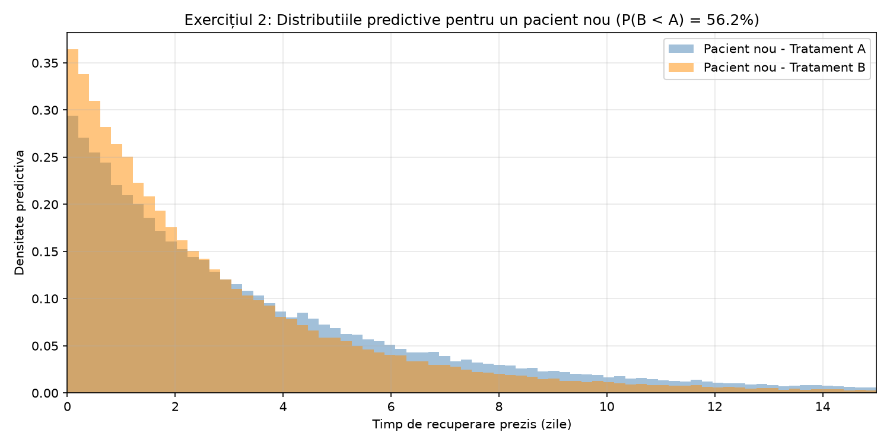
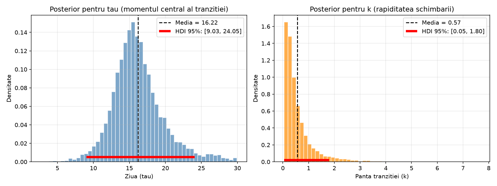
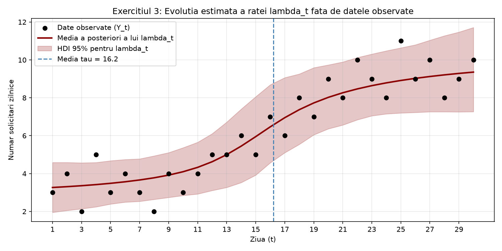
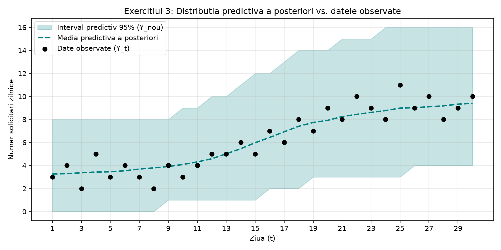

# Tema 7 - Laboratorul 8: Inferenta Bayesiana cu PyMC

Acest repository contine implementarea in Python (PyMC + ArviZ) si analiza rezultatelor pentru cele 3 exercitii de inferenta Bayesiana din Tema 7.

## Structura fisierelor

- `ex1.py`, `ex1_posterior_N.png`, `ex1_predictive_Y.png` - Estimarea dimensiunii unei populatii
- `ex2.py`, `ex2_posterior_medii.png`, `ex2_predictive_pacienti.png` - Compararea a doua tratamente
- `ex3.py`, `ex3_posterior_tau_k.png`, `ex3_evolutie_lambda.png`, `ex3_posterior_predictive.png` - Detectarea unei schimbari graduale a ratei evenimentelor

---

## Exercitiul 1. Estimarea dimensiunii unei populatii

### Model si setari PyMC
- **Model:**
  - $N \sim \text{DiscreteUniform}(20, 200)$
  - $Y \mid N \sim \text{Hypergeometric}(N, M=20, n=15)$, cu observatia $Y = 4$
- **Esantionare MCMC:** `4` lanturi, `2000` iteratii `tune`, `4000` `draws` pe lant (`16000` esantioane totale in posterior), sampler `Metropolis`, `random_seed = 42`.
- **Diagnostice:** `r_hat = 1.00`, `ess_bulk = 3162`, `ess_tail = 3438` (convergenta buna).

### Rezultate numerice
| Indicator | Valoare estimata (PyMC) |
| --- | --- |
| Media a posteriori pentru $N$ | `103.63` |
| Mediana a posteriori pentru $N$ | `96.00` |
| Interval HDI 95% pentru $N$ | `[43, 180]` |
| Estimarea clasica $Mn/Y$ | `75.00` |
| $P(N > 100 \mid Y = 4)$ | `0.4596` (`45.96%`) |
| Verificare exacta (media / $P(N > 100 \mid Y = 4)$) | `102.61` / `0.4494` |
| Media predictiva pentru $Y_{\text{nou}}$ ($n = 15$) | `3.29` (HDI 95%: `[0, 7]`) |

### Grafice

### Interpretare
- **Comparatia cu $Mn/Y$:** Estimatorul clasic Lincoln-Petersen ofera $20 \cdot 15 / 4 = 75$, care corespunde aproximativ modului (varfului) distributiei. Media a posteriori (`103.63`) si mediana (`96.00`) sunt mai mari deoarece distributia a posteriori a lui $N$ este puternic asimetrica spre dreapta: avand doar 4 animale marcate recapturate, raman plauzibile si populatii mari (spre limita superioara de 200), care trag media in sus. Rezultatele MCMC sunt foarte apropiate de calculul exact (`102.61` si `44.94%`).
- **Probabilitatea $P(N > 100 \mid Y = 4)$:** Exista o probabilitate de aproximativ `46%` ca populatia reala sa depaseasca 100 de animale, ceea ce arata o incertitudine mare la un esantion mic.
- **Posteriorul lui $N$ vs. distributia predictiva a posteriori:** Distributia a posteriori a lui $N$ descrie incertitudinea asupra **parametrului necunoscut** al populatiei (numarul total de animale, valori intre 20 si 200). Distributia predictiva a posteriori descrie incertitudinea asupra **unei observatii viitoare** $Y_{\text{nou}}$ (numarul de animale marcate intr-o noua captura de 15 animale, valori intre 0 si 15) si integreaza atat incertitudinea asupra lui $N$, cat si aleatoriul extragerii hipergeometrice.

---

## Exercitiul 2. Compararea a doua tratamente

### Model si setari PyMC
- **Model:**
  - $\lambda_A, \lambda_B \sim \text{Gamma}(2, 4)$ (parametrizarea forma-rata, independente)
  - $X_i^{(A)} \mid \lambda_A \sim \text{Exponential}(\lambda_A)$, $X_j^{(B)} \mid \lambda_B \sim \text{Exponential}(\lambda_B)$
  - Timpii medii de recuperare: $\mu_A = 1/\lambda_A$ si $\mu_B = 1/\lambda_B$
- **Esantionare MCMC:** `4` lanturi, `2000` iteratii `tune`, `4000` `draws` pe lant (`16000` esantioane totale), sampler `NUTS`, `random_seed = 42`.
- **Diagnostice:** `0` divergente, `r_hat = 1.00` pentru toti parametrii, `ess_bulk > 14000`.

### Rezultate numerice
| Indicator | Valoare estimata (PyMC) |
| --- | --- |
| Media a posteriori $1/\lambda_A$ | `3.814` zile (HDI 95%: `[1.712, 6.452]`) |
| Media a posteriori $1/\lambda_B$ | `2.926` zile (HDI 95%: `[1.340, 4.965]`) |
| $P(1/\lambda_B < 1/\lambda_A \mid \text{date})$ | `0.7174` (`71.74%`) |
| $P(X_{\text{nou}}^{(B)} < X_{\text{nou}}^{(A)} \mid \text{date})$ | `0.5619` (`56.19%`) |

### Grafice

### Interpretare
- **Timpii medii de recuperare:** Tratamentul B are un timp mediu estimat mai mic (`2.93` zile) fata de tratamentul A (`3.81` zile), dar intervalele HDI de 95% se suprapun considerabil din cauza volumului mic de date (cate 8 pacienti pe grup).
- **Comparatia mediilor:** Probabilitatea a posteriori ca timpul mediu de recuperare al tratamentului B sa fie mai mic decat cel al tratamentului A este de `71.74%` — un indiciu moderat in favoarea lui B, dar insuficient pentru o concluzie ferma.
- **Comparatia la nivel de pacient nou vs. medii:** Probabilitatea ca un pacient nou tratat cu B sa se recupereze mai repede decat un pacient nou tratat cu A scade la `56.19%` (mult mai aproape de `50%`). Diferenta apare deoarece comparatia de la punctul c) evalueaza doar incertitudinea asupra **mediilor** ($1/\lambda_A$ si $1/\lambda_B$), in timp ce predictia de la punctul d) include in plus **variabilitatea individuala** foarte mare a distributiei exponentiale (unde deviatia standard este egala cu media).

---

## Exercitiul 3. Detectarea unei schimbari graduale a ratei evenimentelor

### Model si setari PyMC
- **Model:**
  - $Y_t \mid \lambda_t \sim \text{Poisson}(\lambda_t)$, $t = 1, \dots, 30$
  - $\lambda_t = \lambda_1 + (\lambda_2 - \lambda_1) \cdot \frac{1}{1 + \exp[-k(t - \tau)]}$
  - Priori independenti: $\lambda_1, \lambda_2 \sim \text{Exponential}(0.2)$, $\tau \sim \text{Uniform}(1, 30)$, $k \sim \text{Exponential}(1)$
- **Esantionare MCMC:** `4` lanturi, `2000` iteratii `tune`, `2000` `draws` pe lant (`8000` esantioane totale), sampler `NUTS`, `target_accept = 0.9`, `random_seed = 42`.
- **Diagnostice:** `0` divergente, `r_hat = 1.00` pentru toti parametrii (`lam1`, `lam2`, `tau`, `k`), `ess_bulk` intre `1394` si `1677`.

### Rezultate numerice
| Parametru / Indicator | Media a posteriori | Interval HDI 95% |
| --- | --- | --- |
| $\lambda_1$ (nivelul initial al ratei) | `2.93` | `[0.61, 4.77]` |
| $\lambda_2$ (nivelul final al ratei) | `9.99` | `[6.86, 14.58]` |
| $\tau$ (momentul central al tranzitiei) | `16.22` | `[9.03, 24.05]` |
| $k$ (rapiditatea schimbarii) | `0.57` | `[0.05, 1.80]` |
| $P(\lambda_2 > \lambda_1 \mid Y_1, \dots, Y_{30})$ | `1.0000` (`100.00%`) | - |
| Zile observate in intervalul predictiv 95% | `30 / 30` (`100.0%`) | - |

### Grafice

### Interpretare
- **Semnificatia parametrilor $\tau$ si $k$:** Parametrul $\tau$ indica ziua in care rata atinge exact jumatatea distantei dintre $\lambda_1$ si $\lambda_2$ (in jurul zilei `16.22`, cu HDI 95% `[9.03, 24.05]`). Parametrul $k > 0$ controleaza panta functiei logistice: valori mici indica o tranzitie lenta, intinsa pe multe zile, iar valori mari ar indica un salt aproape brusc. Media `k = 0.57` (HDI 95% `[0.05, 1.80]`) confirma o trecere lina, graduala.
- **Cresterea ratei:** $P(\lambda_2 > \lambda_1 \mid Y_1, \dots, Y_{30}) = 100\%$, deci exista o certitudine practic completa ca numarul zilnic de solicitari a crescut (de la aproximativ 3 solicitari/zi la inceput spre 9-10 solicitari/zi la final).
- **Verificarea predictiva a posteriori:** Toate cele `30` de observatii zilnice cad in interiorul benzii predictive de 95% si sunt imprastiate echilibrat de o parte si de alta a mediei predictive, fara abateri sistematice. Modelul Poisson cu tranzitie logistica reproduce foarte bine atat forma cresterii graduale, cat si variabilitatea datelor observate.